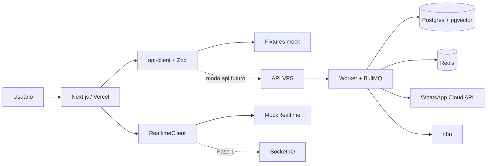

# Tendi

SaaS multi-tenant de atendimento inteligente e CRM conversacional para PMEs brasileiras.

Fase atual: 0A — frontend navegável com dados simulados. Backend, worker, PostgreSQL, Redis, n8n e integrações reais ficam fora do deploy nesta etapa.

## Arquitetura



## Stack

- Frontend: Next.js App Router, TypeScript strict e Tailwind CSS.
- Contratos compartilhados: Zod em `packages/shared`.
- Tempo real: interface RealtimeClient, mock nesta fase e Socket.IO futuramente.
- Backend futuro: Node.js + TypeScript + Fastify + Prisma + BullMQ.

**Fastify em vez de NestJS:** menor overhead e menos estrutura obrigatória para endpoints orientados a webhooks/filas; Zod garante validação e contratos compartilhados; mantém frontend desacoplado e permite evoluir o backend sem alterar telas.

## Desenvolvimento

Requer Node.js 20+ e pnpm 9+.

```bash
pnpm install
pnpm dev
```

Aplicação em http://localhost:3000. Login demonstrativo: e-mail válido e senha não vazia.

```bash
pnpm lint
pnpm typecheck
pnpm test
pnpm build
```

Estrutura: `apps/web`, `apps/api`, `apps/worker`, `packages/shared`, `infra` e `docs`. Pastas de backend e infraestrutura serão preenchidas nas fases futuras. Licença proprietária: UNLICENSED.
